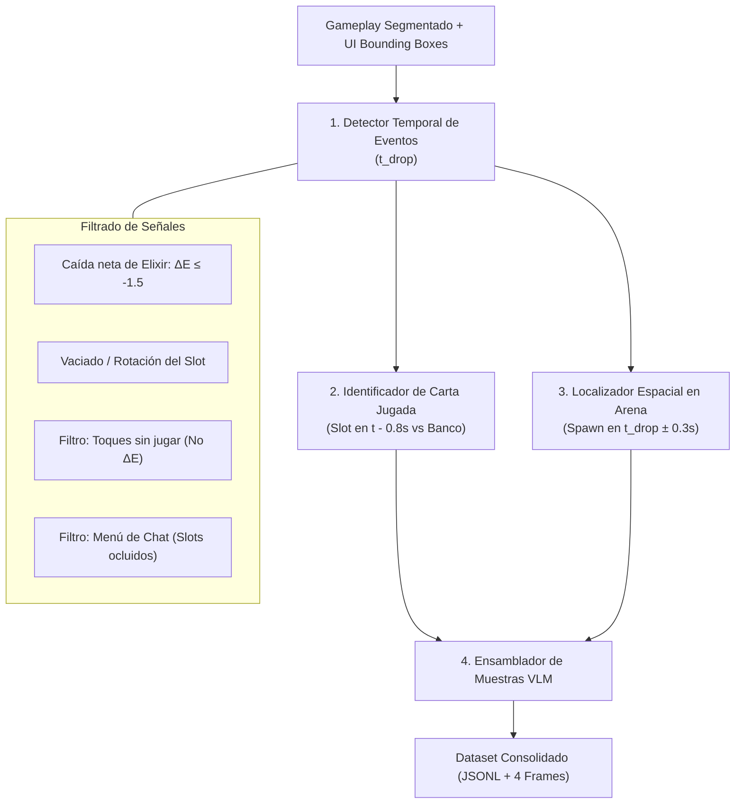

# Especificación de Extracción de Jugadas y Construcción del Dataset (Paso 4B)

Este documento detalla la arquitectura técnica, las invariantes visuales, el manejo de casos borde y la estrategia de implementación para el **Paso 4B** ([`notebooks/03-action-extraction.ipynb`](file:///home/eddu/dev/reinforcement-learning-clash-royale/notebooks/03-action-extraction.ipynb)). Su objetivo es extraer pares de entrenamiento a partir de los videos segmentados ([`metadata/segmented_matches.json`](file:///home/eddu/dev/reinforcement-learning-clash-royale/notebooks/01-segmentation.ipynb)) y las coordenadas calibradas de UI ([`metadata/ui_layouts.json`](file:///home/eddu/dev/reinforcement-learning-clash-royale/notebooks/02-ui-bounding-box.ipynb)).

---

## 1. Visión General y Formato del Dataset

El objetivo del proyecto es entrenar un modelo Vision-Language (VLM) que observe el flujo del juego y sugiera la mejor acción en lenguaje natural como lo haría un jugador experto.

### A. Estructura de Cada Muestra
Cada muestra del dataset se compone de:
1. **Secuencia Visual de 4 Frames:**
   - $t - 6\text{ s}$: Contexto previo (despliegue enemigo, balance inicial).
   - $t - 4\text{ s}$: Evolución de la jugada y trayectoria de tropas.
   - $t - 2\text{ s}$: Situación inmediata de peligro o contraataque.
   - $t_{\text{actual}}$: **Instante crítico de decisión.**
2. **Acción Objetivo (Texto Libre):**
   - Acción activa: `"Juega <Carta> <Zona>"` (ej. `"Juega Valquiria detrás del puente izquierdo"`).
   - Acción pasiva: `"esperar"` (cuando la decisión óptima es acumular elixir o aguardar la respuesta del rival).

> [!IMPORTANT]
> **Prevención de Filtración (*Data Leakage*):**
> El frame $t_{\text{actual}}$ debe capturarse en el intervalo **$t_{\text{drop}} - 0.8\text{ s}$ a $t_{\text{drop}} - 0.5\text{ s}$**, es decir, **inmediatamente antes** de que el jugador suelte la carta. Si se captura después, el modelo vería la carta ya materializada en la arena o la barra de elixir ya vacía, arruinando el aprendizaje predictivo.

---

## 2. Arquitectura de 4 Sub-sistemas Modulares

Para garantizar robustez y facilitar el trabajo colaborativo, la extracción de jugadas se divide en 4 sub-sistemas desacoplados:



---

### Sub-sistema 1: Detector Temporal de Eventos ($t_{\text{drop}}$)

Detecta el segundo exacto en que ocurre una jugada analizando la barra de elixir y la mano del jugador:

1. **Señal Principal (Caída de Elixir):**
   - En Clash Royale, el elixir se regenera de forma continua a velocidad constante (1 elixir cada 2.8s en tiempo regular, cada 1.4s en doble elixir).
   - Una **bajada abrupta de elixir ($\Delta E \le -1.5$)** en una ventana corta ($\le 0.5\text{s}$) indica inequívocamente el gasto de una carta.
2. **Señal Secundaria (Rotación de Slot en Mano):**
   - En el instante de la jugada, uno de los 4 slots calibrados se vacía (se oscurece o entra en cooldown) y luego rota hacia una nueva carta.
3. **Manejo de Casos Borde Críticos:**
   - **Alternar cartas continuamente (jugadores nerviosos/inquietos):** Al tocar cartas, estas se elevan y muestran un borde blanco brillante, pero **el elixir no baja** y el slot no rota. Este comportamiento se descarta automáticamente.
   - **Combos rápidos (2 cartas en < 1.5s):** Se detectan como dos eventos independientes porque se registran dos caídas sucesivas de elixir y dos cambios de slot.
   - **Oclusión por menú de chat / emotes:** Al abrirse el menú de mensajes ("¡Buena suerte!", etc.), un panel azul continuo cubre los 4 slots de cartas. Si los 4 slots presentan la firma de color uniforme del panel de chat, el detector se pausa hasta que el menú se cierre.

---

### Sub-sistema 2: Identificador de la Carta Jugada

Determina qué tropa, estructura o hechizo se utilizó:

1. **Captura Previa:** En $t_{\text{drop}} - 0.8\text{ s}$, el slot de la carta jugada está plenamente visible con su ilustración original.
2. **Banco Canónico de Cartas:**
   - Un catálogo de referencia con los iconos oficiales de las ~110 cartas del juego (incluyendo versiones evolucionadas).
3. **Clasificación y Validación Cruzada:**
   - Comparación visual del slot recortado contra el banco mediante similitud de histogramas / template matching o un extractor de características ligero.
   - **Validación de consistencia:** El coste de la carta identificada debe coincidir con la magnitud de la caída de elixir detectada (ej. si el elixir cayó $\approx 4$ puntos, la carta detectada no puede ser un Espíritu de Hielo de 1 de coste).

---

### Sub-sistema 3: Localizador Espacial en la Arena y Zonas

Determina en qué zona del campo de batalla se colocó la carta:

1. **Detección del Despliegue (Spawn):**
   - En la ventana $[t_{\text{drop}} - 0.2\text{s}, t_{\text{drop}} + 0.4\text{s}]$, en `arena_box` se manifiesta el evento visual de despliegue: el **reloj circular de spawn** (círculo blanco/dorado) o la animación de aparición de la tropa.
   - Aplicando sustracción de fondo o diferencia de fotogramas sucesivos:
     $$\Delta I = |I(t_{\text{drop}} + 0.3) - I(t_{\text{drop}} - 0.3)|$$
   - Se aísla el cúmulo principal de cambio en la mitad propia del campo y se calcula su centroide $(x, y)$.

2. **Mapeo a Lenguaje Natural: Las 6 Posiciones Preliminares**
   Las coordenadas del centroide $(x, y)$ se proyectan sobre las 6 zonas estratégicas del campo propio:

```
               [ Puente Izquierdo ]            [ Puente Derecho ]
           ───────────────────────────┬───────────────────────────
             (1) Detrás puente izq.   │   (2) Detrás puente der.
           ───────────────────────────┼───────────────────────────
             (3) Frente torre izq.    │   (4) Frente torre der.
                  [Torre Izq]         │        [Torre Der]
           ───────────────────────────┴───────────────────────────
                          (5) Centro del campo propio
           ───────────────────────────────────────────────────────
                         [Torre del Rey Propia]
                         (6) Detrás torre del rey
```

| ID | Zona Preliminar | Semántica Estratégica en el Juego |
|---|---|---|
| **1** | **Detrás del puente izquierdo** | Presión ofensiva en el carril izquierdo, colocación de tanques o tropas de choque. |
| **2** | **Detrás del puente derecho** | Presión ofensiva en el carril derecho. |
| **3** | **Frente a la torre izquierda** | Defensa reactiva protegiendo la princesa izquierda de tropas enemigas entrantes. |
| **4** | **Frente a la torre derecha** | Defensa reactiva protegiendo la princesa derecha. |
| **5** | **Centro del campo propio** | Colocación de estructuras defensivas (Cañón, Tesla) o tropas para desviar tanques enemigos a zona neutral. |
| **6** | **Detrás de la torre del rey** | Despliegue pasivo inicial desde el fondo para acumular tropas y ciclar cartas pesadas. |

> [!NOTE]
> Estas 6 zonas representan el esquema preliminar acordado. A nivel interno del dataset, se guardará tanto la etiqueta textual de zona como la coordenada canónica normalizada $(x, y) \in [0, 1]^2$ dentro de `arena_box`, permitiendo en el futuro mapear a cuadrículas más finas (ej. 18×32) sin perder información.

---

### Sub-sistema 4: Muestreo de "Esperar" y Ensamble de Pares

Un jugador de Clash Royale pasa parte significativa de la partida conteniendo sus cartas para acumular elixir o ver qué juega el rival:

1. **Extracción de Ejemplos de "Esperar":**
   - Se seleccionan ventanas de tiempo estables donde no ocurre ninguna jugada durante al menos $3\text{ s}$ consecutivos.
   - Se toma el frame $t$ y sus 3 frames históricos ($-2\text{s}, -4\text{s}, -6\text{s}$).
   - Etiqueta: `"esperar"`.
2. **Balance del Dataset:**
   - Se mantendrá una proporción aproximada de **80% a 85% de acciones de despliegue** y **15% a 20% de decisiones de esperar**, evitando que el modelo se vuelva pasivo o que intente jugar cartas compulsivamente en cada frame.

---

## 3. Formato de Salida de Datos (JSONL)

El archivo de anotaciones generado por el pipeline seguirá la siguiente estructura JSONL:

```json
{
  "sample_id": "fYPBYt4260o_m1_play_004",
  "video_id": "fYPBYt4260o",
  "match_index": 0,
  "timestamp_sec": 42.5,
  "frames": [
    "samples/fYPBYt4260o_m1_play_004_t-6s.jpg",
    "samples/fYPBYt4260o_m1_play_004_t-4s.jpg",
    "samples/fYPBYt4260o_m1_play_004_t-2s.jpg",
    "samples/fYPBYt4260o_m1_play_004_t-0s.jpg"
  ],
  "action_type": "play",
  "card_name": "Valquiria",
  "elixir_cost": 4,
  "hand_slot": 1,
  "placement_coord": [0.284, 0.412],
  "placement_zone": "Detrás del puente izquierdo.",
  "target_text": "Juega Valquiria detrás del puente izquierdo."
}
```

Para ejemplos pasivos:
```json
{
  "sample_id": "fYPBYt4260o_m1_wait_012",
  "video_id": "fYPBYt4260o",
  "match_index": 0,
  "timestamp_sec": 78.0,
  "frames": [
    "samples/fYPBYt4260o_m1_wait_012_t-6s.jpg",
    "samples/fYPBYt4260o_m1_wait_012_t-4s.jpg",
    "samples/fYPBYt4260o_m1_wait_012_t-2s.jpg",
    "samples/fYPBYt4260o_m1_wait_012_t-0s.jpg"
  ],
  "action_type": "wait",
  "card_name": null,
  "elixir_cost": null,
  "hand_slot": null,
  "placement_coord": null,
  "placement_zone": null,
  "target_text": "esperar"
}
```

---

## 4. Plan de Implementación por Fases en el Notebook 03

1. **Fase 1 (Detección Temporal de Jugadas en 1 Video Piloto):**
   - Cargar un video con su segmentación y layout calibrado.
   - Extraer la curva continua de elixir y la métrica de cambio de los 4 slots a lo largo de 1 partida completa.
   - Graficar en matplotlib la curva de elixir con marcadores verticales en las jugadas detectadas, validando el filtrado de toques en mano.
2. **Fase 2 (Catálogo de Cartas y Clasificación de Slots):**
   - Construir el banco de plantillas de cartas.
   - Asociar cada evento detectado a la carta correspondiente en el slot en $t_{\text{drop}} - 0.8\text{ s}$.
3. **Fase 3 (Localización Espacial en Arena):**
   - Aislar el fotograma en $t_{\text{drop}}$ y calcular el mapa de diferencias en `arena_box`.
   - Extraer el centroide $(x, y)$ y proyectarlo en las 6 zonas de la arena.
4. **Fase 4 (Exportación Masiva y Persistencia en Cloudflare R2):**
   - Procesar los videos en bucle con checkpointing atómico por video (`metadata/actions/<video_id>.jsonl`).
   - Subida directa de imágenes y metadatos al bucket R2 (`cr-videos`).

