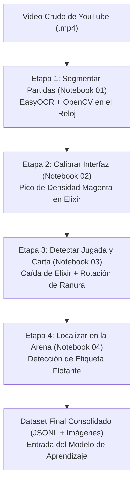

# Sustento Técnico: Extracción de Segmentos, Cajas de Interfaz y Jugadas

Este documento reúne los fundamentos técnicos, decisiones de diseño y respuestas claras para sustentar cómo se construyó el dataset a partir de los videos crudos de YouTube.

---

## 1. Visión General del Pipeline de Extracción

Para convertir horas de video continuo en un dataset estructurado de visión por computadora, desarrollamos un pipeline modular dividido en cuatro etapas independientes. Cada etapa resuelve una pregunta concreta y guarda sus resultados en Cloudflare R2, evitando que un error en una parte arruine el resto del proceso.

---

## 2. Detalle de las Cuatro Etapas

### Etapa 1: Segmentación de Partidas (Aislar el juego real)
- **Pregunta que resuelve:** ¿En qué segundo exacto empieza y termina cada partida dentro de un video largo?
- **Herramientas utilizadas:** OpenCV y EasyOCR.
- **Cómo funciona:** Los videos grabados de YouTube contienen contenido extra que no sirve para entrenar: intros de creadores, pantallas de carga, aperturas de cofres y pantallas de victoria. Para aislar únicamente los minutos de juego real, monitoreamos la esquina superior derecha donde se ubica el reloj de batalla. Leemos el temporizador a un fotograma por segundo con EasyOCR.
- **Criterio de inicio:** La partida arranca oficialmente cuando el reloj marca entre 2:56 y 2:54, que es el momento exacto en que desaparece el cartel de presentación y el jugador toma el control de sus cartas.
- **Criterio de fin:** Si se llega a los 3 minutos reglamentarios o a tiempo extra (Overtime), el reloj sigue corriendo hasta que cae una torre. Al caer la torre decisiva, el juego congela el reloj en ese segundo exacto durante unos 5 a 8 segundos mientras aparecen las coronas y las animaciones de victoria. Nuestro algoritmo detecta esa meseta de lecturas idénticas y corta el clip en el primer segundo congelado, descartando las pantallas finales.
- **Resultado:** 98 partidas oficiales extraídas con precisión de medio segundo.

### Etapa 2: Calibración Espacial de la Interfaz y Cajas Delimitadoras
- **Pregunta que resuelve:** ¿Dónde están ubicadas exactamente la barra de elixir, las 4 cartas de la mano y la arena en celulares con diferentes pantallas?
- **Herramienta utilizada:** OpenCV (análisis de color y geometría fija).
- **Por qué no se calibró a mano:** Cada celular tiene una resolución distinta, formatos alargados con notch o bandas negras laterales. Anotar las coordenadas a mano para decenas de videos sería lento y propenso a errores.
- **Cómo funciona el anclaje automático:** En lugar de buscar las cartas directamente (cuyos dibujos cambian todo el tiempo), buscamos la barra de elixir. La barra tiene un color magenta característico en la parte baja de la pantalla. El algoritmo escanea horizontalmente el 15% inferior buscando la fila con mayor concentración de píxeles magenta. 
- **Cálculo geométrico:** Al fijar esa fila central de la barra con exactitud de un píxel, se derivan matemáticamente las demás regiones:
  - **Barra de elixir:** La caja completa que contiene el número blanco, la gota morada y la barra de carga.
  - **Cuatro cartas de la mano:** Se ubican inmediatamente encima de la barra de elixir. Su altura contempla el margen adicional necesario para cuando el jugador pulsa una carta y esta se eleva dentro de la caja.
  - **Arena de combate:** El rectángulo que cubre todo el campo visible, desde las torres enemigas hasta detrás de la torre del rey propia.
- **Resultado:** Las coordenadas se calculan una sola vez al segundo 8 de la partida y quedan fijadas para todo el video.

### Etapa 3: Detección Temporal de la Jugada e Identificación de la Carta
- **Pregunta que resuelve:** ¿En qué segundo exacto se soltó una carta, qué carta fue y cuál de las cuatro ranuras de la mano se utilizó?
- **Herramientas utilizadas:** OpenCV, catálogo oficial de cartas y reglas del juego.
- **Cómo funciona la detección temporal:** Escaneamos el video a 5 fotogramas por segundo (cada 0.20 segundos) evaluando dos señales obligatorias en simultáneo:
  1. **Caída de elixir compensada:** Medimos el llenado de la barra morada. Calculamos la recarga natural oficial del juego (a velocidad normal, doble o triple según el reloj de la partida). Si la barra cae más de 1.15 puntos considerando la regeneración, confirmamos un gasto real de recursos.
  2. **Rotación de ranura invariante a elevación:** Cuando un jugador toca una carta en la mano sin soltarla, la carta se levanta ligeramente y brilla con un borde blanco. Para no confundir este toque falso con una jugada real, comparamos el centro del dibujo desplazándolo verticalmente. Si el dibujo sigue siendo el mismo, se descarta. Solo se confirma la jugada cuando la ranura se vacía, entra en recarga gris y da paso a una carta nueva.
- **Cómo se identifica la carta jugada:**
  - Contamos con un catálogo oficial de las 160 cartas estándar sincronizadas con sus ilustraciones de referencia.
  - Al confirmarse la jugada, recortamos el interior del slot antes de que desaparezca y lo comparamos contra el catálogo usando histogramas de color en espacio HSV y detección de bordes.
  - **Filtro físico de elixir:** Una carta jamás puede clasificarse como una opción cuyo coste sea mayor al elixir que el jugador tenía disponible en ese fotograma.
  - **Inferencia del mazo de 8 cartas:** En Clash Royale un jugador solo tiene 8 cartas fijas en toda la partida. El algoritmo evalúa primero las jugadas más claras de la partida para descubrir cuáles son las 8 cartas del mazo, y luego reclasifica cualquier jugada dudosa limitándose únicamente a ese grupo de 8 cartas.
- **Prevención de trampa temporal:** El fotograma que se guarda para entrenar al modelo se toma 0.8 segundos antes de que la carta toque la arena. En ese instante previo, la carta aún está en la mano del jugador y la arena está limpia, obligando a la red neuronal a aprender qué jugar en función del estado de la batalla y no reconociendo una tropa que ya está viva.

### Etapa 4: Localización en la Arena y Clasificación de Zona
- **Pregunta que resuelve:** ¿En qué coordenadas de la arena cayó la tropa y a qué zona táctica corresponde?
- **Herramientas utilizadas:** OpenCV (detección de texto flotante y substracción de fondo).
- **Cómo funciona la localización:** Cuando un jugador coloca una carta en Clash Royale, aparece sobre la baldosa de destino el nombre de la carta flotando en letras blancas o doradas con contorno negro junto al indicador de nivel. Detectamos la aparición de este texto sobre la arena para obtener las coordenadas exactas de impacto.
- **Ventaja frente a la resta de movimiento simple:** Si solo midiéramos diferencia de píxeles o movimiento, cartas que viajan por debajo de la tierra (como el Minero o el Taladro) marcarían erróneamente movimiento en el río mientras viajan en vez de marcar la torre enemiga, y las defensas en el centro se confundirían con las tropas que pelean en los puentes. El texto flotante aparece siempre y de forma exclusiva en la baldosa exacta donde nacerá la tropa.
- **Mapeo a zonas tácticas:** La coordenada detectada se clasifica en una de las diez zonas estratégicas de la arena (puente izquierdo, puente derecho, frente a las torres, centro defensivo, detrás del rey o torres enemigas).

---

## 3. Preguntas Típicas del Profesor y Cómo Responderlas

### ¿Por qué no anotaron las jugadas a mano con una herramienta gráfica?
Anotar a mano más de tres mil jugadas cuadro por cuadro tomaría cientos de horas y tendría errores humanos de milisegundos en el momento de reacción y en las coordenadas exactas. Con el pipeline automático basado en reglas del juego, procesamos las partidas de manera consistente, matemática y completamente reproducible.

### ¿Por qué usaron EasyOCR para el reloj pero no para las cartas o el elixir?
EasyOCR es excelente para leer números sobre fondos contrastados que cambian cada segundo, como el reloj de la partida. Sin embargo, procesar OCR en cada cuadro a 5 fotogramas por segundo es extremadamente pesado y lento en cómputo. Para la barra de elixir y las cartas de la mano, el análisis directo de color y la comparación de plantillas con OpenCV es instantáneo, liviano y mucho más preciso.

### ¿Cómo garantizan que la red no memorice la tropa que ya cayó en la arena?
El fotograma que recibe el modelo se extrae exactamente 0.8 segundos antes del impacto de la carta. En ese instante previo, la tropa todavía no existe en el campo de batalla y la carta aún está en la mano del jugador. La red neuronal está obligada a analizar la posición del rival, la barra de elixir y la mano para decidir qué hacer, sin posibilidad de hacer trampa.

### ¿Qué ocurre si el jugador abre el menú de frases o reacciones y tapa las cartas?
El sistema incluye un filtro que revisa si el menú azul de reacciones está abierto sobre la mano. Cuando este panel cubre las ranuras, se pausa temporalmente la detección para evitar registrar cartas falsas.

### ¿De dónde salieron las muestras de "esperar"?
En Clash Royale saber cuándo no gastar elixir es fundamental para no quedar desprotegido. El sistema busca momentos de la partida donde pasan más de 6.5 segundos sin ninguna jugada y extrae muestras intermedias con la orden de "esperar" en la zona neutral. Estas decisiones representan el 16.5% del dataset, asegurando que el modelo aprenda tanto a jugar como a ser paciente.

