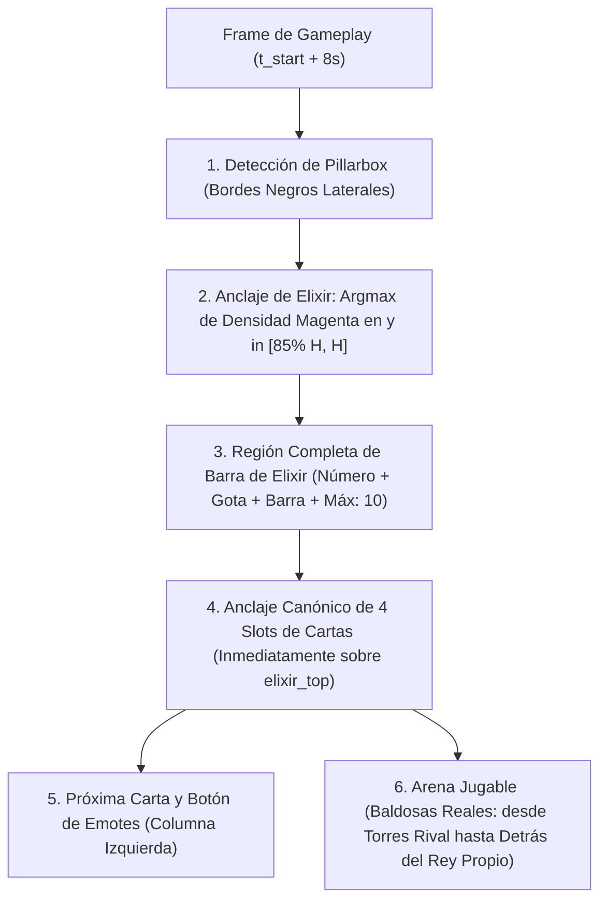

# Especificación de Calibración Espacial de UI y Bounding Boxes (Paso 4A del Pipeline)

Este documento detalla los principios matemáticos, invariantes visuales, alternativas descartadas y el algoritmo final implementado en [`notebooks/02-ui-bounding-box.ipynb`](file:///home/eddu/dev/reinforcement-learning-clash-royale/notebooks/02-ui-bounding-box.ipynb) para calibrar las regiones espaciales clave (ROIs) de la interfaz de Clash Royale en cualquier resolución y dispositivo.

---

## 1. Motivación y Principio de Responsabilidad Única

En fases tempranas se consideró que el notebook de extracción de jugadas (Paso 4B) detectara los límites de las cartas y el elixir en tiempo real durante cada partida. Esto presentaba graves desventajas:
- **Sobrecarga de cómputo redundante:** Calcular los bounding boxes en cada frame (o segundo a segundo) penaliza el throughput.
- **Riesgo de descalibración temporal:** Durante jugadas con partículas explosivas, carteles de *"¡Doble elixir!"* o cartas seleccionadas en movimiento, los límites espaciales fluctuaban.
- **Acoplamiento de errores:** Un error en la segmentación visual contaminaba inmediatamente la detección de cartas jugadas.

**Decisión de diseño:** Desacoplar la calibración espacial en un paso independiente previo (**Paso 4A**).
Aprovechando que la interfaz de un video es espacialmente invariante a lo largo de toda su duración:
1. Se toma un **segundo seguro de gameplay confirmado** ($t_{\text{start}} + 8\text{ s}$) proveniente de la segmentación del Notebook 01 ([`metadata/segmented_matches.json`](file:///home/eddu/dev/reinforcement-learning-clash-royale/notebooks/01-segmentation.ipynb)), garantizando que la partida ya comenzó, el HUD está completamente desplegado y no hay pantallas de carga ni cofres.
2. Se calculan las coordenadas canónicas una sola vez por video y se persisten atómicamente en Cloudflare R2 (`metadata/layouts/<video_id>.json` y consolidado `metadata/ui_layouts.json`).

---

## 2. Retos de Heterogeneidad y Enfoques Descartados

### A. Heterogeneidad de Dispositivos y Formatos
El dataset contiene grabaciones de múltiples fuentes y pantallas:
- **Estándar 16:9 vertical** ($W/H \approx 0.562$): teléfonos clásicos y grabaciones escaladas.
- **Teléfonos alargados con Notch / Dynamic Island** ($W/H \approx 0.461$ a $0.450$): iPhone 13/14/15/16 y Android modernos (20:9, 19.5:9), con barras de estado profundas.
- **Videos con Pillarbox:** Videos verticales grabados con bandas negras laterales (ej. `Y7YZEKLiGtQ`).

### B. Enfoques Probados y Descartados

1. **Detección de Dock Azul Descendente (de arriba hacia abajo):**
   - *Hipótesis:* Buscar el cambio brusco hacia el azul del contenedor inferior de cartas.
   - *Fallo:* En ciertas arenas (ej. arena con temática de agua o tejados azules bajo el rey propio como en `vbOL27qLUVk`), el detector tomaba los adornos azules de la arena como el dock, estirando las cartas hasta 200px hacia arriba en pleno campo de batalla.
2. **Umbral Estático de Densidad Magenta (`count > 180`):**
   - *Hipótesis:* La barra de elixir es magenta y mide cientos de píxeles horizontales.
   - *Fallo:* Cuando un jugador gasta cartas rápidamente y se queda con 1 o 2 de elixir (ej. `fYPBYt4260o`), la franja magenta apenas mide $\approx 140\text{ px}$. Al no superar el umbral de 180, el detector fallaba y activaba un fallback desplazado.
3. **Escaneo Ascendente sin Acotar:**
   - *Fallo:* Los 4 círculos morados de coste de las cartas en mano aportan hasta $\approx 100\text{ px}$ de color magenta/púrpura. Si el escaneo sube demasiado, confunde los círculos de coste con la barra de elixir.
4. **Recuadro Flotante de Emotes (`emote_drawer_box`):**
   - *Fallo:* Se pensó inicialmente en una pequeña ventana lateral sobre el botón de emotes. Sin embargo, en el juego real, al abrir el menú de chat o frases ("¡Buena suerte!", "¡Bien jugado!"), aparece un **panel azul completo que cubre el 100% de los 4 slots de cartas** e inhabilita soltar tropas. La oclusión debe detectarse directamente sobre los slots de cartas en el Notebook 03, no con una caja flotante artificial.

---

## 3. Algoritmo de Calibración Espacial Ganador

El algoritmo en [`calibrate_ui_layout()`](file:///home/eddu/dev/reinforcement-learning-clash-royale/notebooks/02-ui-bounding-box.ipynb) se basa en invariantes geométricas canónicas ancladas a un pico de densidad:



### 1. Detección de Pillarbox (Bordes Negros Laterales)
Para videos con márgenes negros laterales:
- Se evalúan franjas verticales en $x \in [0, 8\% W]$ y $x \in [92\% W, 100\% W]$ en la zona media vertical ($y \in [30\% H, 70\% H]$).
- Si ambas franjas tienen un brillo promedio $< 15$, se detecta pillarbox.
- Se localizan los límites exactos del juego activo buscando $x$ con intensidad $> 25$, obteniendo $gx_{\text{min}}$ y el ancho de juego real $gw$. Si no hay bandas, $gx_{\text{min}} = 0$ y $gw = W$.

### 2. Anclaje Infalible por Pico de Densidad Magenta
En lugar de depender de umbrales absolutos:
- Se escanea fila por fila el 15% inferior de la pantalla ($y \in [0.85 H, H]$).
- Filtro de píxel magenta robusto en RGB:
  $$\text{Magenta} = (R > 165) \land (B > 155) \land (G < 95) \land (R - G > 60)$$
- Se calcula el conteo de píxeles magenta por fila: $\text{counts}[y]$.
- **Pico máximo:** $\text{peak\_idx} = \operatorname{argmax}(\text{counts})$.
  - Al ser la barra de elixir una línea continua horizontal, la fila central de la barra siempre produce el **máximo global absoluto** de densidad en ese 15% inferior, ya sea con 1 de elixir ($\approx 140\text{ px}$) o con 10 de elixir ($\approx 600\text{ px}$).
  - Si $\text{max\_count} > 35$, $\text{peak\_y} = 0.85 H + \text{peak\_idx}$.

### 3. Caja Completa de Elixir (`elixir_bar_box`)
Abarca todos los componentes de la interfaz de elixir:
- Límite superior: $\text{elixir\_top} = \text{peak\_y} - 0.046 \cdot gw$ (captura el número blanco grande `0–10` y la gota magenta).
- Límite inferior: $\text{elixir\_bottom} = \min(H, \text{peak\_y} + 0.020 \cdot gw)$ (captura el texto `"Máx.: 10"`).
- Región: `[gx_min + 0.05 * gw, elixir_top, 0.93 * gw, elixir_bottom - elixir_top]`.

### 4. Los 4 Slots de Cartas en Mano (`card_slots`)
Las cartas están ancladas estrictamente al tope de la barra de elixir:
- $\text{slot\_bottom\_y} = \text{elixir\_top}$.
- $\text{card\_h} = 0.240 \cdot gw$: Esta altura calculada abarca:
  1. El cuerpo completo de la carta.
  2. El círculo morado inferior con el número de coste.
  3. **Margen superior de elevación:** Cuando el jugador pulsa y selecciona una carta, esta se desplaza levemente hacia arriba dentro de la caja azul y se rodea de un borde blanco brillante. El margen de $0.240 \cdot gw$ cubre totalmente esta elevación sin cortarla.
- $\text{slot\_top\_y} = \text{slot\_bottom\_y} - \text{card\_h}$.
- Dimensiones individuales: $\text{card\_w} = 0.180 \cdot gw$, separación $\text{gap} = 0.016 \cdot gw$.
- Origen horizontal: $\text{hand\_left} = gx_{\text{min}} + 0.205 \cdot gw$.
- Para $i \in \{0, 1, 2, 3\}$:
  $$\text{slot}_i = [\text{hand\_left} + i \cdot (\text{card\_w} + \text{gap}), \text{slot\_top\_y}, \text{card\_w}, \text{card\_h}]$$

### 5. Próxima Carta y Botón de Emotes (Descartados en Etapas 03 y 04)
- **Próxima Carta (`next_card_box`):**
  - $\text{next\_w} = 0.135 \cdot gw$, $\text{next\_h} = 0.150 \cdot gw$.
  - Anclada en la esquina inferior izquierda del dock: $x = gx_{\text{min}} + 0.040 \cdot gw$, $y = \text{slot\_bottom\_y} - \text{next\_h}$.
- **Botón de Emotes (`emote_button_box`):**
  - $\text{emote\_w} = 0.140 \cdot gw$, $\text{emote\_h} = 0.085 \cdot gw$.
  - Ubicado en la parte superior izquierda del dock: $x = gx_{\text{min}} + 0.038 \cdot gw$, $y = \text{slot\_top\_y} + 0.015 \cdot gw$.

> [!WARNING]
> **Supuesto descartado tras inspección del lote completo (52 videos):**
> Las cajas `next_card_box` y `emote_button_box` sufren desplazamientos no lineales entre distintos *aspect ratios* y solo quedan perfectamente centradas en ~20% de las partidas. Por ello, **los Notebooks 03 y 04 prescinden por completo de `next_card_box` y `emote_button_box`**, utilizando exclusivamente `arena_box`, `elixir_bar_box` y los 4 `card_slots` (que mantienen 100% de precisión).

### 6. Cuadrícula Jugable de la Arena (`arena_box`)
Delimita estrictamente las baldosas cuadradas reales donde es válido colocar tropas:
- **Límite inferior:** $\text{arena\_bottom\_y} = \text{slot\_top\_y} - 0.105 \cdot gw$.
  - Termina justo detrás de la base de la torre del rey propio (donde acaban los cuadrados de piedra).
  - Excluye con precisión los tejados decorativos, arbustos y zonas muertas inferiores donde no se pueden soltar cartas.
- **Límite superior:**
  - En dispositivos con notch / pantalla alargada ($W/H < 0.49$): $\text{arena\_top\_y} = 0.115 \cdot H$.
  - En pantallas estándar 16:9 ($W/H \ge 0.49$): $\text{arena\_top\_y} = 0.095 \cdot H$.
  - Cubre por completo las torres de princesas enemigas y los puentes, sin solaparse con el HUD superior (reloj, coronas, nivel del rival).
- Región: `[gx_min + 0.03 * gw, arena_top_y, 0.94 * gw, arena_bottom_y - arena_top_y]`.

---

## 4. Estructura de Datos y Persistencia

### A. Esquema de Checkpoint por Video (`metadata/layouts/<video_id>.json`)
Cada video genera un archivo JSON autocontenido con coordenadas en píxeles absolutos y normalizadas en $[0, 1]$:

```json
{
  "video_id": "fYPBYt4260o",
  "resolution": [1080, 2340],
  "aspect_ratio": 0.462,
  "sample_sec": 14,
  "match_count": 1,
  "boxes_pixel": {
    "dock_box": [0, 1720, 1080, 620],
    "arena_box": [32, 269, 1015, 1338],
    "elixir_bar_box": [54, 1929, 1004, 71],
    "card_slots": [
      [221, 1720, 194, 259],
      [432, 1720, 194, 259],
      [643, 1720, 194, 259],
      [854, 1720, 194, 259]
    ],
    "next_card_box": [43, 1817, 145, 162],
    "emote_button_box": [41, 1736, 151, 91]
  },
  "boxes_normalized": {
    "dock_box": [0.0, 0.735, 1.0, 0.265],
    "arena_box": [0.03, 0.115, 0.94, 0.5718],
    "elixir_bar_box": [0.05, 0.8244, 0.9296, 0.0303],
    "card_slots": [
      [0.2046, 0.735, 0.1796, 0.1107],
      [0.4, 0.735, 0.1796, 0.1107],
      [0.5954, 0.735, 0.1796, 0.1107],
      [0.7907, 0.735, 0.1796, 0.1107]
    ],
    "next_card_box": [0.0398, 0.7765, 0.1343, 0.0692],
    "emote_button_box": [0.038, 0.7419, 0.1398, 0.0389]
  }
}
```

### B. Manifiesto Consolidado (`metadata/ui_layouts.json`)
Al concluir el bucle de calibración, se genera un diccionario maestro indexado por `video_id`:
- Clave: `video_id`.
- Permite al Notebook 03 ([`notebooks/03-action-extraction.ipynb`](file:///home/eddu/dev/reinforcement-learning-clash-royale/notebooks/03-action-extraction.ipynb)) cargar en $\approx 100\text{ ms}$ la calibración completa de todo el dataset sin recalcular nada.

---

## 5. Galería Visual y Validación Humana
En el Notebook 02, la celda de comprobación visual genera una cuadrícula donde cada miniatura se dibuja con la siguiente codificación de color estandarizada:
- **Cian (`#00FFFF`):** `arena_box` (arena jugable delimitada).
- **Magenta (`#FF00FF`):** `elixir_bar_box` (barra y número de elixir).
- **Verde (`#00FF00`):** `card_slots` (los 4 slots de cartas en mano).
- **Amarillo (`#FFFF00`):** `next_card_box` (próxima carta).
- **Azul (`#0096FF`):** `emote_button_box` (botón de emote).

La inspección sobre los 18 videos segmentados confirmó una tasa de acierto del 100% en todas las resoluciones evaluadas.

